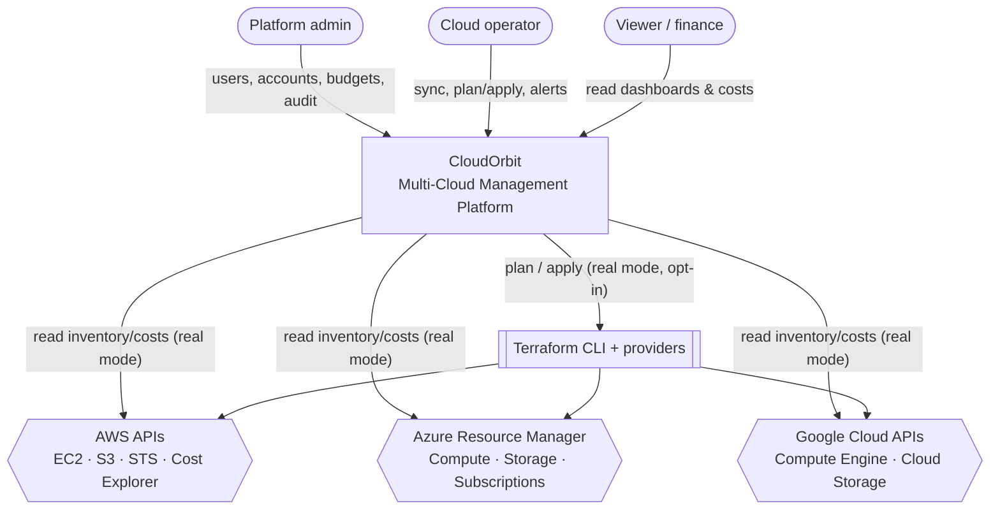
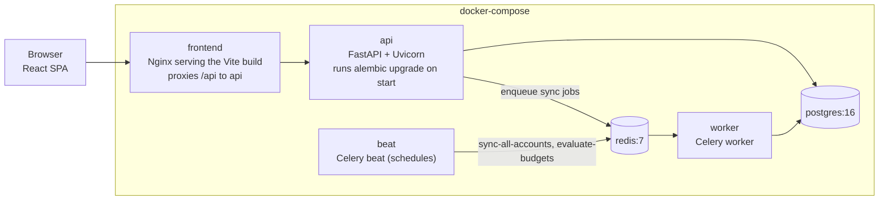
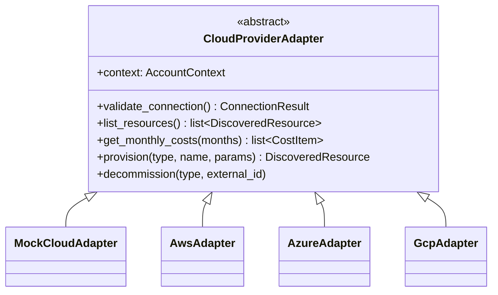
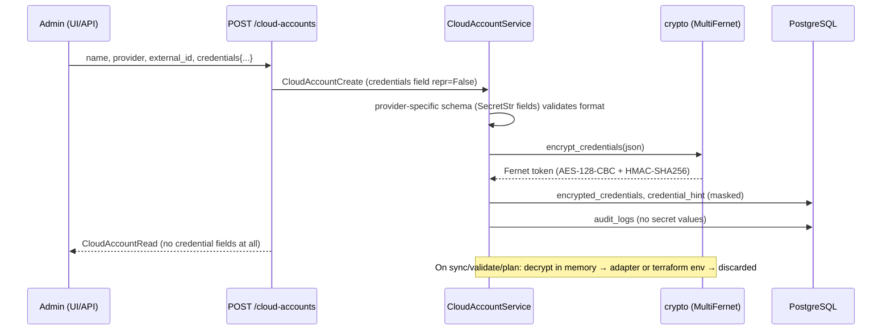
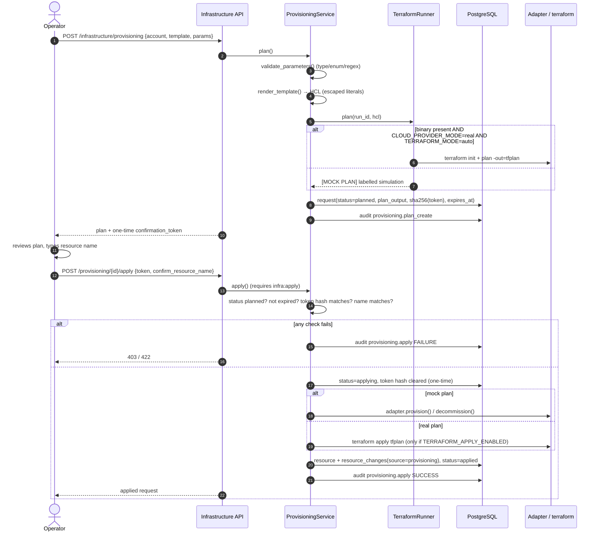
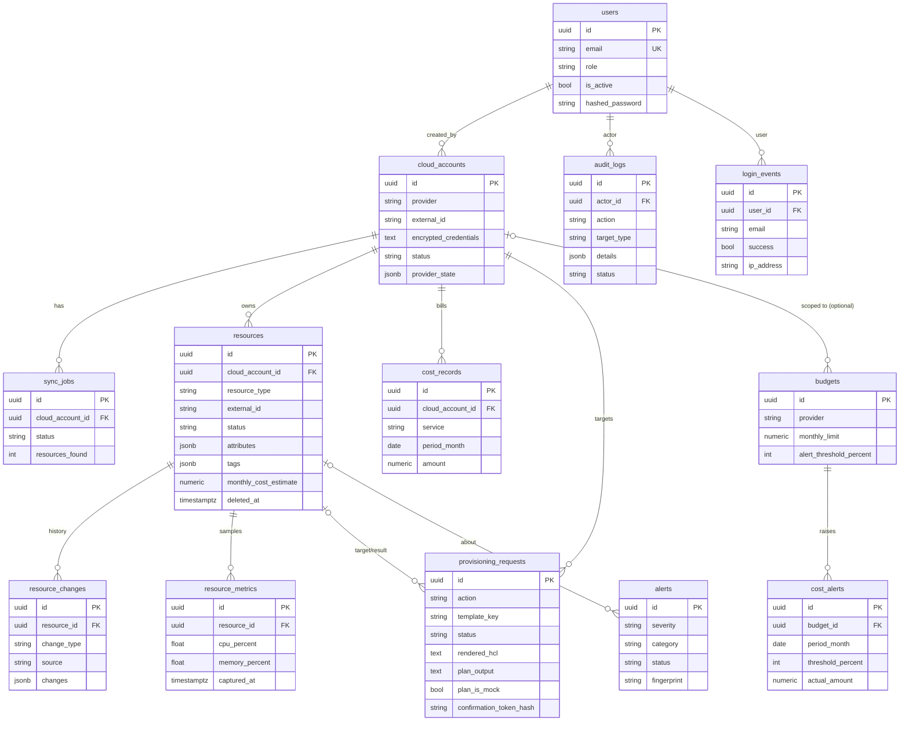

# CloudOrbit architecture

This document describes how CloudOrbit is put together and why. Paths are relative to the repository root.

## 1. System context



## 2. Containers



Without Redis (local development, tests), `CELERY_TASK_ALWAYS_EAGER=true` makes `task.delay()` run in-process. The API code path is identical either way.

## 3. Backend layers

```
app/api/routes/*      HTTP: validation (Pydantic), auth + RBAC dependencies, response models
        │
app/services/*        business rules, transactions, audit records, alert raising
        │
app/repositories/*    SQLAlchemy queries (no business rules)
        │                         app/providers/*        cloud adapter interface + implementations
app/models/*  ──► PostgreSQL      app/infrastructure/*   Terraform catalog, renderer, runner
```

- **API layer** (`app/api`): routers are thin. `deps.py` provides the DB session (`get_db`), `get_current_user` (JWT), `require(Permission)` (RBAC), `RequestContext` (actor, IP, user agent) and pagination.
- **Service layer** (`app/services`): `AuthService`, `CloudAccountService`, `InventoryService`, `ProvisioningService`, `CostService`, `AlertService`, `DashboardService`, `AuditService`. Services own the commit boundary, and each mutation records an audit entry in the same transaction.
- **Repository layer** (`app/repositories`): a generic `Repository[Model]` (get, add, delete, paginate) plus domain repositories with aggregate queries (counts by column, cost totals by provider and month, latest metric per resource, hourly usage series via `date_trunc`).
- **Errors** (`app/core/errors.py`): a domain exception hierarchy (`NotFoundError`, `ConflictError`, `PermissionDeniedError`, `BusinessRuleError`, `ProviderError`…) mapped to HTTP status codes in a single envelope `{"error": {"code", "message", "details"}}`. Unhandled exceptions are logged and returned as a generic 500 with no internal details.

## 4. Provider-adapter pattern



- `app/providers/factory.py::get_adapter()` is the single selection point. With `CLOUD_PROVIDER_MODE=mock` (the default) it returns `MockCloudAdapter`. With `real` it lazily imports `AwsAdapter`, `AzureAdapter` or `GcpAdapter`, so the SDKs are **optional extras** and the default install and test suite never import them. A missing SDK raises `ProviderUnavailableError` (HTTP 501) with the install command.
- Adapters return provider-neutral dataclasses (`DiscoveredResource`, `CostItem`, `ResourceUsage`) with normalised statuses (`running`, `stopped`, `available`…). The inventory service doesn't know which cloud it is talking to.
- The **mock adapter** is deterministic per account (seeded from the external id). It adds hourly drift (occasional power-state flips, CPU samples) so repeated syncs produce realistic change history. Simulated provisioning is persisted in `cloud_accounts.provider_state` (JSONB), so it survives restarts and is shared by the API and worker processes.

## 5. Credential encryption flow



- Keys come from `CREDENTIALS_ENCRYPTION_KEYS` (comma-separated). The first key encrypts and all keys decrypt (MultiFernet), so a key can be rotated without downtime. Production startup fails if keys are missing.
- The response schema `CloudAccountRead` has **no** credential fields. Only `credential_hint` (e.g. `AKIA********PLE1`) is exposed.
- `app/core/logging.py` installs a `RedactingFilter` that scrubs secret-looking keys and inline `secret=…` patterns. Audit `details` pass through `redact()` before storage, and Terraform output is redacted before it is persisted.

## 6. Terraform plan → confirm → apply



## 7. Background jobs

| Task | Trigger | What it does |
|---|---|---|
| `mcmp.sync_account(job_id)` | `POST /cloud-accounts/{id}/sync`, beat | `InventoryService.run_sync`: list resources, reconcile (create/update/status/delete + history), store metrics, raise/resolve alerts, refresh 6 months of costs, evaluate budgets |
| `mcmp.sync_all_accounts` | beat, every `SYNC_INTERVAL_MINUTES` | Creates a `sync_jobs` row per active account and enqueues `sync_account` |
| `mcmp.evaluate_budgets` | beat, hourly | Creates idempotent `cost_alerts` for crossed thresholds |

Each sync is recorded in `sync_jobs` (queued → running → succeeded/failed) with counts and an error message. If the broker is unreachable, the job is marked failed with "Task queue unavailable" instead of the request returning a 500.

## 8. Data model



The schema source of truth is `backend/alembic/versions/`. `database_schema.sql` is a generated reference dump.

## 9. RBAC matrix

| Permission | admin | operator | viewer |
|---|:-:|:-:|:-:|
| `users:manage` | ✓ | | |
| `accounts:read` | ✓ | ✓ | ✓ |
| `accounts:write` (create/update/delete/rotate/validate) | ✓ | | |
| `resources:read` | ✓ | ✓ | ✓ |
| `resources:sync` | ✓ | ✓ | |
| `infra:read` | ✓ | ✓ | ✓ |
| `infra:plan` (preview/plan/cancel/decommission plan) | ✓ | ✓ | |
| `infra:apply` | ✓ | ✓ | |
| `costs:read` | ✓ | ✓ | ✓ |
| `budgets:write` | ✓ | | |
| `alerts:manage` | ✓ | ✓ | |
| `audit:read` | ✓ | | |

Defined in `app/core/permissions.py` and exposed at `GET /api/v1/users/roles`. The frontend hides actions the user lacks, but the backend is the enforcement point.

## 10. Audit logging

- `AuditService.record()` writes to `audit_logs` in the **same transaction** as the change, so an audited action can't commit without its record.
- Recorded actions include `user.register`, `auth.login` (success/failure), `user.profile_update`, `user.password_change`, `user.create`, `user.admin_update`, `cloud_account.create/update/delete/validate/credentials_rotate`, `resource.sync_requested`, `resource.sync`, `provisioning.plan_create/plan_destroy/apply/cancel`, `budget.create/update/delete`, `alert.acknowledged/resolved`.
- `login_events` holds access history (IP, user agent, failure reason). Unknown e-mails still run a bcrypt check so response timing doesn't reveal which accounts exist.
- `resource_changes` holds per-resource lifecycle history (source `sync` or `provisioning`, and the actor where applicable).

## 11. Frontend architecture

- **Stack**: Vite + React 18 + TypeScript (strict), Tailwind CSS, TanStack React Query, React Router v6, Recharts, lucide-react icons.
- **API client** (`src/api/client.ts`): a typed `fetch` wrapper that adds the bearer token, parses the error envelope into an `ApiError`, and clears the session on 401. Endpoint functions and response types live in `src/api/`.
- **Auth** (`src/auth/`): `AuthProvider` keeps the token in `sessionStorage`, loads `/auth/me`, and exposes `can(permission)` built from a mirror of the role matrix (`src/auth/permissions.ts`). `ProtectedRoute` redirects unauthenticated users to `/login`.
- **Data fetching**: `useQuery`/`useMutation` per page with query keys per resource, cache invalidation after mutations, and a 60-second refresh on the overview. Sync jobs return their final state synchronously in eager mode; there is no client-side job polling yet.
- **Design system** (`src/components/ui/`): `Button`, `Card`, `StatCard`, `PageHeader`, `Spinner`, `EmptyState`, `ErrorState`, `CodeBlock`, `Badge`/`StatusBadge`/`ProviderBadge`, `TextField`/`SelectField`, `Modal`, `DataTable`/`Pagination`. They share dark-first Tailwind tokens (`canvas`, `surface`, `line`, `ink`, `muted`, `orbit`, `nebula`) defined in `tailwind.config.js`, and chart styling lives in `src/components/charts.ts`.
- **Layout**: a responsive sidebar (collapsible on mobile) and top bar with the user menu.
- **Pages** (10): Login, Register, Overview, Cloud accounts, Inventory, Infrastructure, Cost analytics, Monitoring, Activity logs, Settings (profile, password, users, role matrix).
- **Tests**: Vitest + React Testing Library, 46 tests (helpers, components, and whole pages with a mocked API module).

## 12. Design decisions and trade-offs

| Decision | Why | Trade-off |
|---|---|---|
| Synchronous SQLAlchemy + FastAPI sync endpoints | Simpler transactions, reused unchanged by Celery tasks and the seed script; FastAPI runs sync endpoints in a threadpool | Lower peak concurrency than full async. Fine for an admin console's load. |
| PostgreSQL only (JSONB, `date_trunc`) | Production parity; tests catch real SQL issues | Tests need a Postgres server (solved with service containers / embedded binaries) |
| Enums stored as strings | Painless migrations when adding values | No DB-level enum constraint; validated in Pydantic and services |
| Mock adapters as the default | Anyone can run the whole product offline; deterministic tests | Mock data isn't real. Every mock output is labelled (`[MOCK PLAN]`, `[MOCK APPLY]`, adapter name in validation results). |
| Confirmation token + typed name for apply | Prevents accidental or replayed applies, separating plan from apply | One extra step for operators (by design) |
| Real destroy disabled | Destroying real resources needs the Terraform state that created them; guessing is unsafe | Real decommissioning stays in your Terraform pipeline |
| Mock provider state in `cloud_accounts.provider_state` | Shared between API and worker processes, survives restarts | Couples one JSONB column to the mock implementation (documented and ignored by real adapters) |
| Access token only (no refresh token) | Smaller attack surface for a v1 | Users sign in again after `ACCESS_TOKEN_EXPIRE_MINUTES` |
