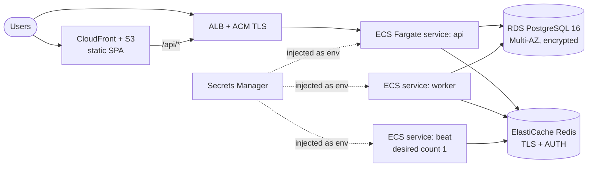

# Deployment guide

> The Docker images and `docker-compose.yml` are provided and reviewed, but they were **not built or run
> in the author's environment** (Docker was not available there). CI builds and tests the code itself,
> not the images. Treat the first `docker compose up` as a smoke test.

## 1. Docker Compose on a single VM

Suitable for demos, internal tools and small teams.

```bash
git clone https://github.com/vks-eng/multi-cloud-management-platform.git && cd multi-cloud-management-platform
cp .env.example .env
# Edit .env: ENVIRONMENT=production, strong POSTGRES_PASSWORD, JWT_SECRET_KEY, CREDENTIALS_ENCRYPTION_KEYS,
#            ALLOW_SELF_REGISTRATION=false, CORS_ORIGINS=https://cloudorbit.example.com
docker compose up -d --build
docker compose ps                     # api should become "healthy" (it runs alembic upgrade head first)
curl -s localhost:8000/api/v1/health  # {"status":"ok","database":"ok",...}
```

Services: `postgres` (named volume `pgdata`), `redis`, `api` (port 8000), `worker` (Celery),
`beat` (Celery schedules), `frontend` (unprivileged nginx on container port 8080, published on 5173,
proxying `/api/` to `api`).

Put a TLS-terminating reverse proxy (Caddy, Nginx, Traefik) in front of the `frontend` service and do not
publish port 8000 or 5432 to the internet.

The first user to register becomes the admin. Register yourself, then set `ALLOW_SELF_REGISTRATION=false`
and restart `api`.

**Never run `python -m app.seed` in a shared environment.** It creates documented demo passwords
(the script refuses to run when `ENVIRONMENT=production`).

### Backups and upgrades

```bash
docker compose exec postgres pg_dump -U mcmp -Fc mcmp > cloudorbit-$(date +%F).dump    # backup
docker compose exec -T postgres pg_restore -U mcmp -d mcmp --clean < cloudorbit-2026-11-10.dump  # restore
git pull && docker compose up -d --build    # api applies new migrations on start
docker compose exec api alembic downgrade -1   # roll back one migration if needed
```

## 2. AWS reference architecture (ECS Fargate + RDS + ElastiCache)



* **Images:** push `backend/` and `frontend/` images to ECR (or host the SPA build in S3 + CloudFront).
* **Tasks:** one task definition per role (api / worker / beat) using the same backend image with a
  different `command`. Exactly **one** beat task.
* **Migrations:** run `alembic upgrade head` as a one-off ECS task in the deploy pipeline before rolling
  the api service, or keep the default container command, which runs it at start-up.
* **Networking:** RDS and ElastiCache in private subnets; security groups allow only the ECS tasks.
* **Health checks:** ALB target group → `GET /api/v1/health/live`; deployment check → `GET /api/v1/health`
  (returns 503 if the database is unreachable).
* **IAM:** the task role needs **no** cloud-management permissions. CloudOrbit uses the per-account
  credentials stored (encrypted) in the database. Task execution role: ECR pull, CloudWatch Logs,
  `secretsmanager:GetSecretValue` on the CloudOrbit secrets only.

## 3. Secrets handling

| Secret | Where it lives | Notes |
|---|---|---|
| `JWT_SECRET_KEY` | Secret manager → env | ≥ 32 random chars; rotating it signs everyone out |
| `CREDENTIALS_ENCRYPTION_KEYS` | Secret manager → env | Comma-separated Fernet keys. Rotate by **prepending** a new key, then re-save credentials. Remove the old key only after every account has been rotated. |
| `POSTGRES_PASSWORD` / `DATABASE_URL` | Secret manager → env | Use RDS IAM auth or Secrets Manager rotation |
| Cloud credentials | PostgreSQL, Fernet-encrypted | Entered through the UI/API, never returned or logged |

`ENVIRONMENT=production` makes the app refuse to start with the default JWT secret or without encryption
keys.

## 4. Production checklist

- [ ] `ENVIRONMENT=production`, strong `JWT_SECRET_KEY`, `CREDENTIALS_ENCRYPTION_KEYS` from a secret manager
- [ ] `ALLOW_SELF_REGISTRATION=false` after the first admin exists
- [ ] `CELERY_TASK_ALWAYS_EAGER=false` with Redis reachable; exactly one beat instance
- [ ] `CORS_ORIGINS` limited to your real origin(s); HTTPS everywhere
- [ ] PostgreSQL backups scheduled and a restore tested
- [ ] `TERRAFORM_APPLY_ENABLED` left `false` unless you have reviewed the Terraform IAM scope ([cloud-providers.md](cloud-providers.md))
- [ ] Logs shipped to your log platform; alert on `audit_logs` failures and 5xx rates
- [ ] No demo seed data
